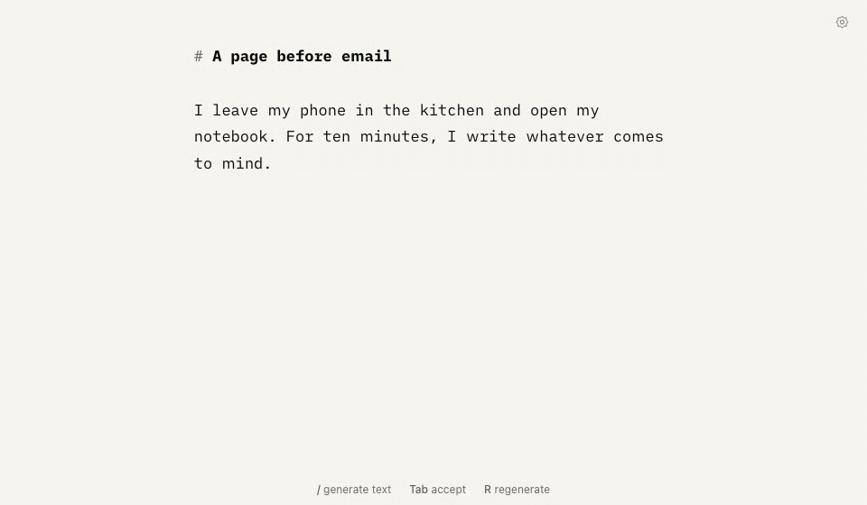

# Stilura

A local writing editor with AI continuations, answers and rewrites beside your text. Preview new wording, then accept it into your draft.



## Run

```bash
npx stilura
```

Requires Node.js 20+. Run from your writing folder; the editor opens at [localhost:3000](http://127.0.0.1:3000), or the next free port. Open Settings to choose a provider, model and sign-in method or API key.

Desktop builds: [Releases](https://github.com/vadimchirkov/stilura/releases) for macOS, Windows and Linux.

## Write

- **Continue:** pause while typing to get a continuation. `Cmd/Ctrl+Enter` requests one explicitly.
- **Change:** select text and click **Change**, or press `Cmd/Ctrl+K`. Ask a question, request a rewrite or find synonyms. For replacement options, use ↑/↓ to choose.
- **Generate:** type `/` followed by a request at the end of a line, then press `Enter`. For example: `/Write a short introduction about urban gardens`.

`Tab` accepts a preview; `Escape` dismisses it or stops generation. `R` regenerates a passage replacement or generated text. Unaccepted previews stay outside the saved draft.

## Settings and files

Settings control the provider, model, reasoning level and appearance. Edit `style.md` in your writing folder to set the voice and constraints; changes apply without restarting.

The draft saves to `draft.md` in that folder. Browser storage keeps a recovery copy. The desktop app also stores settings in its application data directory. `Cmd/Ctrl+S` downloads a copy of the draft.

Override the draft or style path when starting:

```bash
DRAFT_FILE=./article.md STYLE_FILE=./style.md npx stilura
```

Model requests send draft text to your selected provider.

## Development

```bash
git clone https://github.com/vadimchirkov/stilura.git
cd stilura
npm install
npm start
```

Node.js HTTP server, CodeMirror 6 frontend and Tauri desktop shell.

```bash
npm run build       # bundle frontend
npm run check       # build and tests
npm run desktop     # desktop development; requires Rust and Tauri prerequisites
```

[API and storage details](SPEC.md) · [Agent workflow](skills/stilura/SKILL.md)

## License

[MIT](LICENSE)
