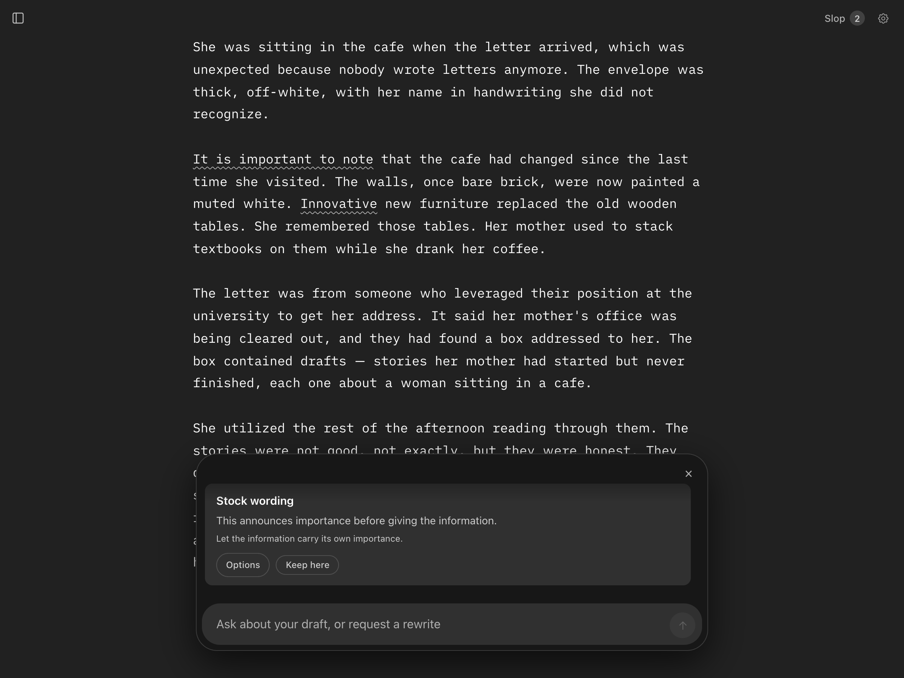

# Stilura

Local AI writing enhancer that writes with you. It highlights generic, AI-sounding phrases in your draft, names the pattern, and offers rewrites. Nothing changes until you pick one.

```bash
npx stilura
```



> **Renamed from Litura.** The npm package moved from `litura-app` to `stilura`, the repository from `vadimchirkov/litura` to `vadimchirkov/stilura`. Your files stay where they are.

## How it works

Stilura checks your draft against 20 named patterns in `style.md`: sales language, vague attribution, forced triples, filler openers, stacked qualifiers, and more. A second pass catches structural issues like buried points and broken paragraph promises.

- **Options** — three rewrites for any finding. Hover to preview, click to apply.
- **Discuss** — chat about a passage or the whole draft.
- **Brief** (`/brief`) — tell it who reads this and what it should do. Rewrites aim at that reader; review stays unbiased.
- **Continuations** — short next-line suggestions appear when you pause. `Tab` to accept, `Escape` to dismiss.

Click the count in the header to see all findings. `F8` / `Shift+F8` to step between them. `Keep as is` dismisses one for good.

## Run

```bash
npx stilura
```

Needs Node 20+. Opens [http://127.0.0.1:3000](http://127.0.0.1:3000). Choose a provider and model under the gear button.

**Desktop:** download from [Releases](https://github.com/vadimchirkov/stilura/releases) (`.dmg` / `.exe` / `.AppImage` / `.deb`). On macOS, unsigned: `System Settings → Privacy & Security → Open Anyway` on first launch.

**Shortcuts:** `Cmd/Ctrl+K` — chat. `Cmd/Ctrl+Enter` — continuation. `Cmd/Ctrl+S` — download draft. `/` in composer — commands.

## Configuration

Use the gear button to choose a provider, model, and reasoning level. Stilura also finds credentials stored by Pi and provider environment variables. ChatGPT Plus/Pro sign-in works as an alternative to an API key.

```bash
PI_PROVIDER=anthropic
PI_MODEL=claude-sonnet-4-6
PI_THINKING_LEVEL=medium
PORT=3000
STYLE_FILE=./style.md
DRAFT_FILE=./draft.md
```

Edit `style.md` to describe the voice and constraints to preserve. Changes apply without restarting.

## Data

The draft lives in `draft.md` in your folder. Findings, chat, brief, and model choice live in browser local storage. Nothing leaves the machine except model requests to the provider you chose.

The desktop app saves state under its application data directory, so changing ports does not reset it. Updates check GitHub on launch; accepting verifies the bundle against a signing key and restarts.

## Agent integration

The draft is a plain file, and the server exposes what the UI uses as HTTP endpoints. A skill for Claude Code / Codex ships in `skills/stilura/SKILL.md`:

```bash
cp -r skills/stilura ~/.claude/skills/
```

### MCP server

Seven stdio tools — `draft_read`, `draft_write`, `review`, `rewrite`, `suggest`, `chat`, `idea` — in `mcp-server.mjs`. Same prompts as the editor, same revision guard.

```bash
# Claude Code
claude mcp add --scope user stilura -- node /path/to/stilura/mcp-server.mjs
```

```toml
# Codex: ~/.codex/config.toml
[mcp_servers.stilura]
command = "node"
args = ["/path/to/stilura/mcp-server.mjs"]
cwd = "/path/to/writing"
tool_timeout_sec = 180
```

## Development

```bash
git clone https://github.com/vadimchirkov/stilura.git
cd stilura && npm install && npm start
```

Node native HTTP server. Vanilla JS frontend with CodeMirror 6, bundled by esbuild (`src/app.js` → `public/app.js`).

```bash
npm run build       # bundle frontend
npm run check       # lint + tests
npm run desktop     # Tauri desktop shell (needs Rust + Tauri prerequisites)
```

See [SPEC.md](SPEC.md) for API contracts and behavior details.

## License

[MIT](LICENSE)
